# LMS Moodle-like - ERD

This is the logical data model for the project's planned LMS features. GitHub
renders the Mermaid block below as a visual ER diagram.

```mermaid
erDiagram
    USERS {
        bigint id PK
        varchar email UK
        varchar password_hash
        varchar full_name
        varchar status
        datetime created_at
    }

    ROLES {
        bigint id PK
        varchar code UK
        varchar name
        varchar scope
    }

    SYSTEM_ROLE_ASSIGNMENTS {
        bigint user_id PK, FK
        bigint role_id PK, FK
        varchar role_scope FK
        datetime assigned_at
    }

    COURSE_CATEGORIES {
        bigint id PK
        bigint parent_id FK
        varchar name
        text description
    }

    COURSES {
        bigint id PK
        bigint category_id FK
        bigint created_by FK
        varchar course_code UK
        varchar title
        text description
        varchar status
        datetime start_at
        datetime end_at
    }

    COURSE_MEMBERSHIPS {
        bigint course_id PK, FK
        bigint user_id PK, FK
        bigint role_id FK
        varchar role_scope FK
        varchar status
        datetime joined_at
        datetime updated_at
    }

    COURSE_SECTIONS {
        bigint id PK
        bigint course_id FK
        varchar title
        int position
        varchar status
    }

    ACTIVITIES {
        bigint id PK
        bigint section_id FK
        bigint created_by FK
        varchar activity_type
        varchar title
        int position
        varchar status
        datetime available_from
        datetime available_until
    }

    LESSONS {
        bigint activity_id PK, FK
        longtext content
    }

    ASSIGNMENTS {
        bigint activity_id PK, FK
        datetime due_at
        decimal max_grade
        boolean allow_late_submission
    }

    SUBMISSIONS {
        bigint id PK
        bigint assignment_id FK
        bigint student_id FK
        int attempt_number
        longtext text_content
        varchar status
        datetime submitted_at
        datetime created_at
    }

    GRADES {
        bigint submission_id PK, FK
        bigint graded_by FK
        decimal score
        text feedback
        datetime graded_at
        datetime released_at
    }

    COURSE_ANNOUNCEMENTS {
        bigint id PK
        bigint course_id FK
        bigint author_id FK
        varchar title
        longtext content
        varchar status
        datetime published_at
        datetime updated_at
    }

    FILES {
        bigint id PK
        bigint uploaded_by FK
        varchar storage_key UK
        varchar original_name
        varchar mime_type
        bigint size_bytes
    }

    ACTIVITY_FILES {
        bigint activity_id PK, FK
        bigint file_id PK, FK
        varchar purpose
        int position
    }

    SUBMISSION_FILES {
        bigint submission_id PK, FK
        bigint file_id PK, FK
    }

    ACTIVITY_COMPLETIONS {
        bigint activity_id PK, FK
        bigint user_id PK, FK
        varchar status
        datetime completed_at
    }

    USERS ||--o{ SYSTEM_ROLE_ASSIGNMENTS : has_system_roles
    ROLES ||--o{ SYSTEM_ROLE_ASSIGNMENTS : assigned_at_system_level

    COURSE_CATEGORIES o|--o{ COURSE_CATEGORIES : parent_of
    COURSE_CATEGORIES o|--o{ COURSES : categorizes
    USERS ||--o{ COURSES : creates

    COURSES ||--o{ COURSE_MEMBERSHIPS : has_members
    USERS ||--o{ COURSE_MEMBERSHIPS : joins
    ROLES ||--o{ COURSE_MEMBERSHIPS : role_in_course

    COURSES ||--o{ COURSE_SECTIONS : contains
    COURSE_SECTIONS ||--o{ ACTIVITIES : contains
    USERS ||--o{ ACTIVITIES : creates

    ACTIVITIES ||--o| LESSONS : lesson_details
    ACTIVITIES ||--o| ASSIGNMENTS : assignment_details

    ASSIGNMENTS ||--o{ SUBMISSIONS : receives
    USERS ||--o{ SUBMISSIONS : submits
    SUBMISSIONS ||--o| GRADES : receives_grade
    USERS ||--o{ GRADES : grades

    COURSES ||--o{ COURSE_ANNOUNCEMENTS : has_announcements
    USERS ||--o{ COURSE_ANNOUNCEMENTS : authors

    ACTIVITIES ||--o{ ACTIVITY_FILES : uses_files
    FILES ||--o{ ACTIVITY_FILES : attached_to_activity
    SUBMISSIONS ||--o{ SUBMISSION_FILES : includes_files
    FILES ||--o{ SUBMISSION_FILES : attached_to_submission

    ACTIVITIES ||--o{ ACTIVITY_COMPLETIONS : tracks_completion
    USERS ||--o{ ACTIVITY_COMPLETIONS : completes
```

## How to read the model

- `||` means exactly one; `o|` means zero or one; `o{` means zero or many.
- `COURSE_MEMBERSHIPS` connects users to courses. Its `role_id` is the user's
  role in that particular course, so one person can teach one course and study
  in another.
- `ROLES.scope` distinguishes system roles from course roles. Composite foreign
  keys prevent a course role from being assigned as a system role (and vice
  versa). `SYSTEM_ROLE_ASSIGNMENTS` is for roles such as `ADMIN`.
- A course is organized into sections and activities. `ACTIVITIES` contains
  common fields; `LESSONS` and `ASSIGNMENTS` hold fields specific to those
  activity types. Each activity should have at most one matching detail row.
- Each submission represents one attempt. The combination of
  `(assignment_id, student_id, attempt_number)` must be unique. A submission
  can have zero or one grade.
- `ACTIVITY_FILES` and `SUBMISSION_FILES` link stored files to learning
  activities and student submissions without putting multiple optional owner
  foreign keys in `FILES`.
- `ACTIVITY_COMPLETIONS` records a learner's status for each activity. Overall
  course progress can be calculated from these records.
- Status and date-range checks are enforced by MySQL. A submission may be a
  draft, so its `submitted_at` is nullable; only submitted work receives a
  timestamp. Grades can be saved before release using `released_at`.

The service layer must still enforce cross-table rules that MySQL CHECK
constraints cannot express: course creators and authors must have the
appropriate course role; only active students in the course may submit; only
course staff may grade; and a grade must not exceed that assignment's
`max_grade`. It must also ensure an activity has exactly one matching detail
row for its type (`LESSON`, `ASSIGNMENT`, or `RESOURCE`).

This is the group's scoped Moodle-like MVP, not a full Moodle database. Quiz,
forum, messaging, gradebook aggregation, groups, and advanced enrolment
methods are intentionally left for later extensions.
